downloading the docker zip file into the shared folder of the VM. Unzip the docker file and run the docker-compose.yml.
commands:
"docker-compose up -d" or "dcup" (use to initiate the docker).
"dockps" (list all the docker connections).
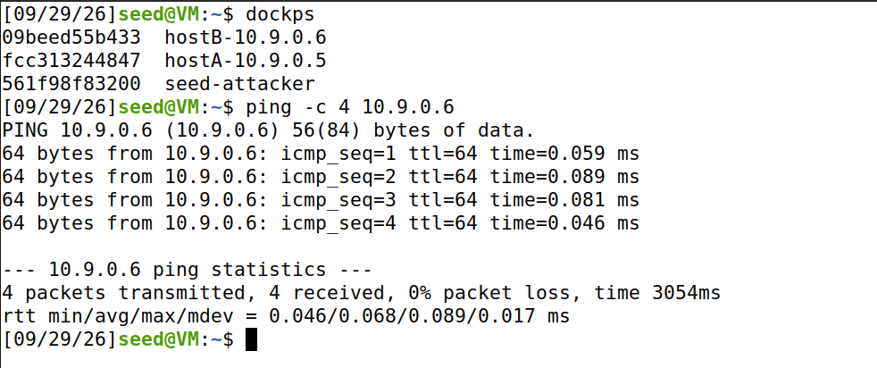

Open wireshark and use the filter on the top bar for "icmp" to see the ping traffic between attacker(hostA) to hostB.
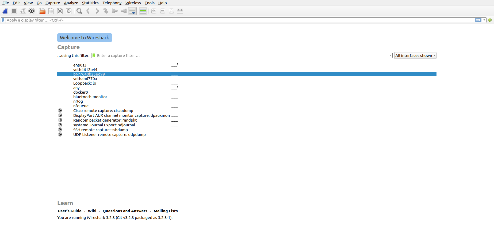
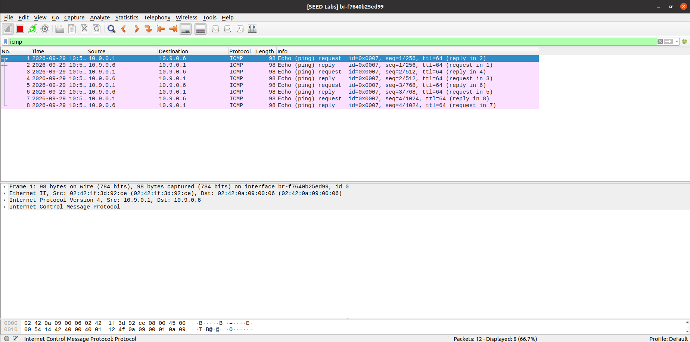

After finished using docker, use "dcdown" to shutdown existing connections.
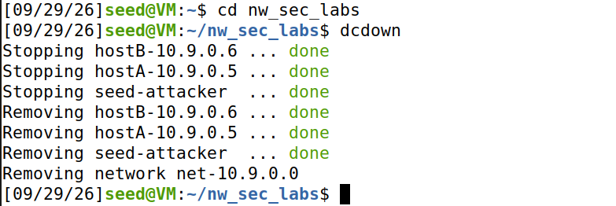

## **Task 1.1A: Sniffing ICMP**
Use command 'ifconfig' to check the the iface of the machine, 'br-7652d9fd4808' in this case (note that every time when you initiate docker, the iface can be different.)
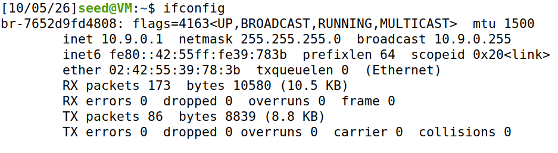

Create a python script to sniff icmp traffic, in this case the file is named "sniffer1.py", and execute the python script with "sudo python3 'filename', in this case 'filename' is 'sniffer1.py'.
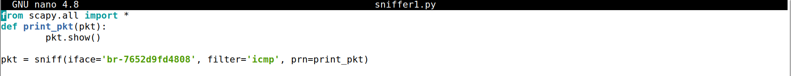

In another terminal, use 'dockps' to check the container ips, and use 'docksh' to execute a container.
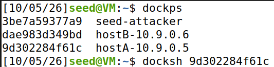

Use the 'ping' command to ping a host which generate icmp traffic, go to the terminal which is running 'sniffer.py', observe the capture icmp packets
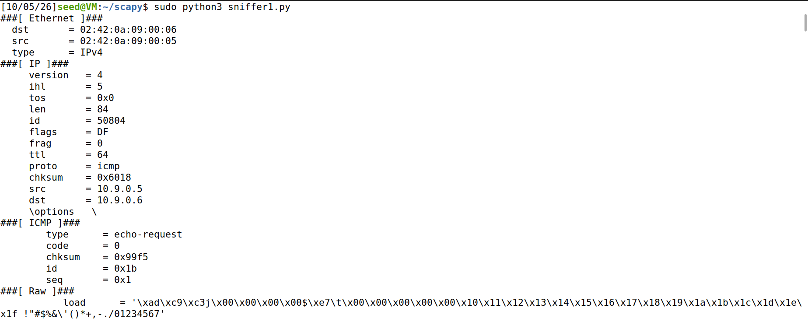

Change the script instead of ".show()" to ".summary", but ".summary()" does not automatically print in the terminal, so the new line of code would be "print(pkt.summary())".
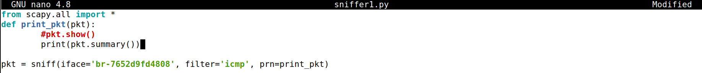

## **Task1.1B: Sniffing TCP/subnet**
Create a new sniffer script similar to 'sniffer1.py' to sniff tcp traffic, change the filter from 'icmp' tp 'tcp'.
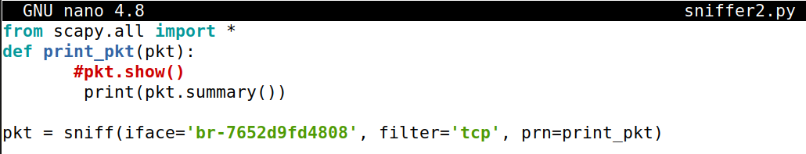

Enter hostB container, and telnet into hostA to create tcp traffic. Observe the tcp packets captured by the new sniffer.
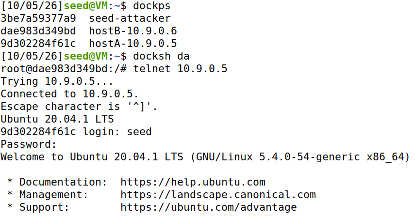
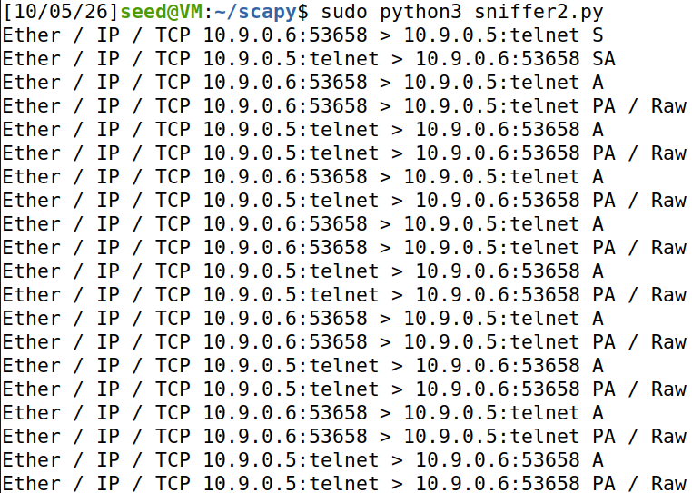

Create a new sniffer script but for specific subnet, change the filter to 'net 128.230.0.0/16'.

Ping from any of the container, and use 'ping 128.230.0.11' to ping the entire subnet('ping -c 4 128.230.0.11' to limit the pings to 4).

As the ifconfig picture above, the subnet mask of the iface is '255.255.255.0', which means that the subnet is /24, 256 addresses total (254 usable, .0 and .255 are reserved for network and broadcast address).

## **Task 1.2: Spoofing**
Create a Spoofing file which would ping an address when run.
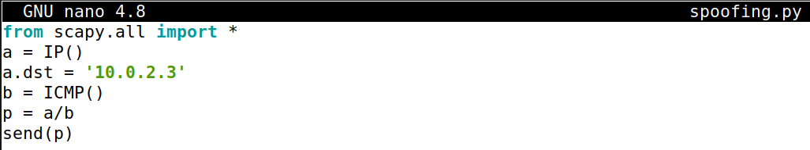
'IP()' creates a IP object from the IP class, which defines attributes from the IP header field. '.dst' set the destination IP address in the field, if not set the default IP will be used (127.0.0.1). 'ICMP()' creates a ICMP object, similar to 'IP()'. By 'a/b' we stack a and b together to form a new object. The / operator is overloaded by the IP class, so it no longer represents division; instead, it means adding b as the payload field of a and modifying the fields of a accordingly. As a result, we get a new object that represent an ICMP packet. Finally we 'send()' 'p'.

Before running the script, launch Wireshark and select the correct interface. In the previous tasks, the 'br-...' interface was chosen to observe traffic between different containers in a simulated enviroment. However, the spoofing script does not target any of the containers of docker. 'enp0s3' will be chosen as it is the network interface of the VM machine. (the 'any' interface will also work)
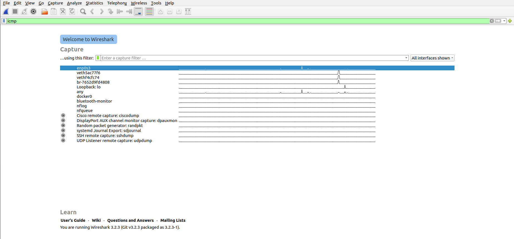

After specific the filter for 'icmp', run the spoofing script to send a packet to the VM machine, and observe the traffic on Wireshark.
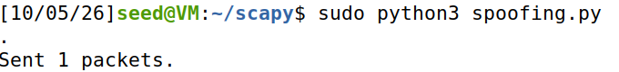
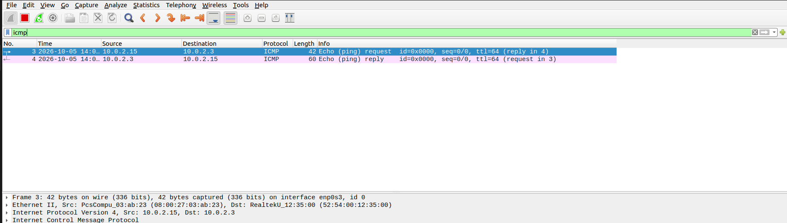

