## Overview
The following lab follows the document [**TCP/IP Attack Lab**](https://seedsecuritylabs.org/Labs_20.04/Files/TCP_Attacks/TCP_Attacks.pdf). Download the lab setup files at [**TCP Attacks lab**](https://seedsecuritylabs.org/Labs_20.04/Networking/TCP_Attacks/). this lab will covers:
 • The TCP protocol
 • TCP SYN flood attack, and SYN cookies
 • TCP reset attack
 • TCP session hijacking attack
 • Reverse shell

## **Task 1: SYN Flooding Attack**
The concept of SYN flooding is similar to a Denial of Service attack, overwhelm a host with TCP requests. By default UbuntuOS has SYN Cookie Countermeasure enabled, stop minimize the effects of an SYN flood attack. We can turn off the countermeasure with the following command.
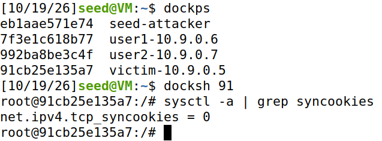
To turn off the countermeasure, set "net.ipv4.tcp_syncookies=0". To turn on the countermeasure, set "net.ipv4.tcp_syncookies=1".
 Notes that the command can only performed within a container, we used the victim container.

### **Task 1.1: Launching the Attack Using Python**
We will first create a SYN Flooding script with Python, call "synflood.py".
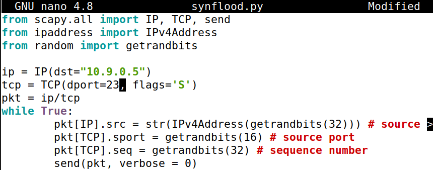
Run the Python script, and observe the results in the victim's container.
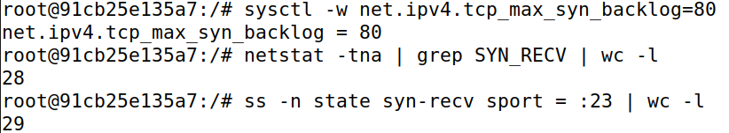
The default TCP backlog size is 80, one fourth of the backlog is reserved for "proven destinations", so 60 should be the max capacity. The results shows 28 and 29, because Python/Scapy flood is too slow, and cannot fill all the backogs.

### **Task 1.2: Launch the Attack Using C(language)**

For this task, we will create a new script with C, Python/Scapy script is not as quick compared with C. We will create the new script named "synflood.c". We will first turn off Ubuntu countermeasure cookie first.
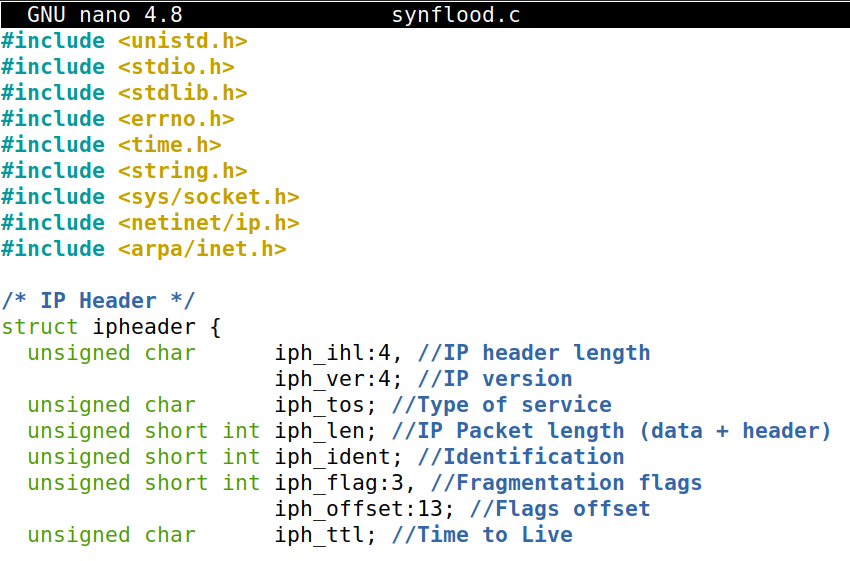
The Python Scapy library already knows what a IP and TCP headers looks like, the student only needs to modify fields like destination, port, SYN flag. C script does not have such function, the student is required to manually input all the fields such as: header length, version, type of service, total length, identification, fragmentation flags, TTL.

 After completing the script, the student is required to comply the script in the attacker container, to do that we have to first move the script into the shared folder (volumes) of this lab file. The path should be "../Labsetup/volumes", after moving the C script into the "volumes" folder, the student would need to comply the C script in this directory, the command would be "gcc -o volumes/synflood synflood.c".
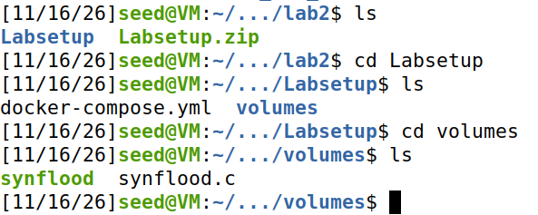
After complying the C script, the student would need to get into the attacker container to launch the attack. The student will then need to change directory to the "volumes", where the C script is complied then execute the C script.
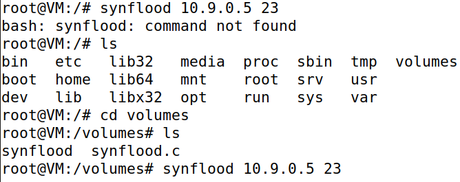
We will then get back into the victim container, and see the result.
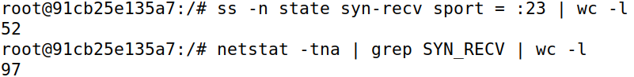
Afterwards, we will turn on the countermeasure, and compare results.
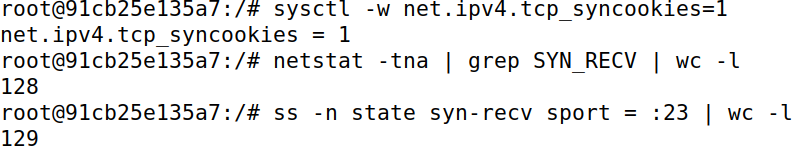
The reason why the countermeasure has a higher number is because how server process packets. With Cookies OFF, each SYN the server reserves a slot in the backlog queue to hold that connection, the number represent how many slots are in the queue that the server is waiting for an ACK. With Cookies ON, the server do not reserve any slots for SYN, and only wait for a client to send an ACK, then the server will open a slot, the high number represent how many SYN_RECV state it has received.

 The reason why this is important, is that when the Cookies is OFF, when the queue is maxed, anymore SYN will get turned away, casuing an DoS(Denial of Service).

 But the server is not completely vulnerable during a SYN Flood attack. On Ubuntu 20.04, a kernel mitigation mechanism is implemented, if a known host which has established connection with the server before, tries to connect to the server during a SYN Flood attack, the server will recognize the known host IP address, and establish connection easier. The command to check known host is "ip tcp_metrics show"
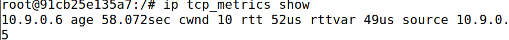

## **Task 2: TCP RST Attacks on telnet Connections**
A TCP RST Attack can terminate an established TCP connections between 2 hosts. The student is required to create a Python script similar to the Spoof script last lab, but this time to reset an alreadt established Telnet connections between 2 hosts, we will Telnet user1 to user2. The script will be named "rst.py".
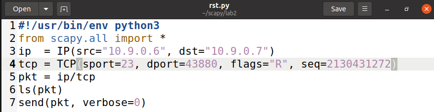
Flag "R" stands for "Reset", the student will need to use the client IP address and source port as "src" and "sport"(default Telnet source port is 23), while the server IP address and destination port as "dst" and "dport". The student will need to use WireShark to sniff packets for details.
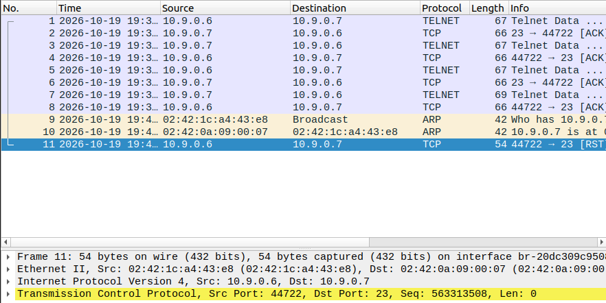
The complication of this task, is that the sequence number changes when the client enters any inputs in the terminal, it is important that the student to **NOT TOUCH THE CLIENT TERMINAL** when performing this task. Sometimes the Telnet will retransmit a TCP request to keep the Telnet connection alive, so speed on modifying the Python script is also the essence.

 An easier solution is to create an auto script for Python to sniff the details of the latest TCP packet, and put in the those details in the corresponding fields. We will name this script "autoRST.py".
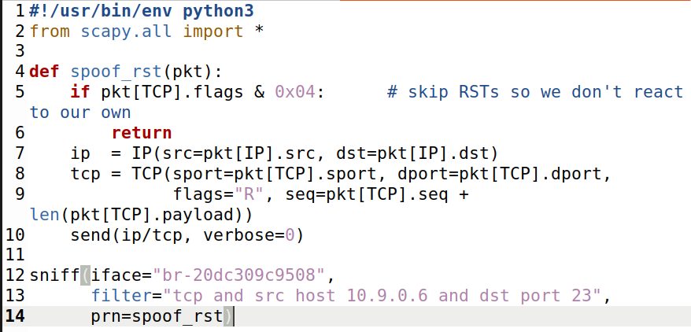
We will run the "autoRST.py", and observe on WireShark and the client terminal, the Telnet connection should be closed.
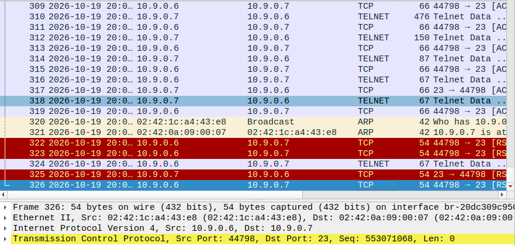
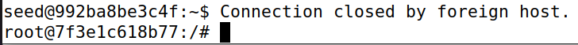